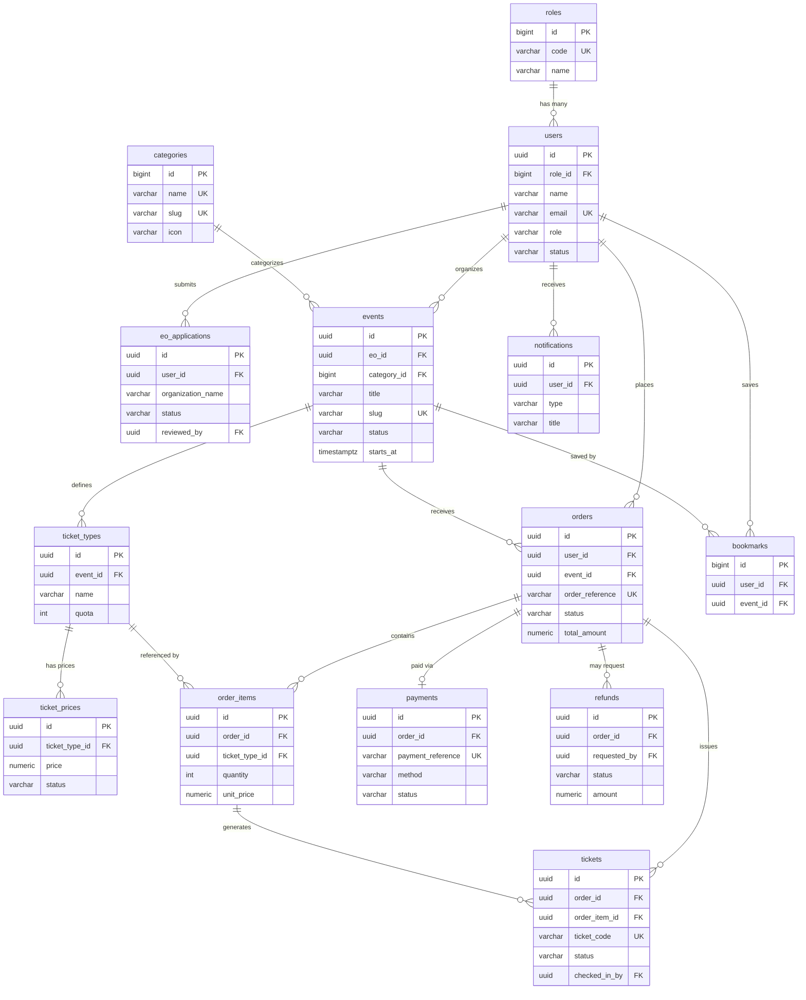

# Hajirin - Integrated Event Management & E-Ticketing System

**Hajirin** adalah platform manajemen event dan e-ticketing berbasis web menggunakan **Laravel 13**, **PostgreSQL**, dan **Inertia.js + React**. Aplikasi ini mengintegrasikan katalog event publik, pemesanan tiket digital dengan QR Code, manajemen acara oleh Event Organizer (EO), hingga moderasi, manajemen data master, dan pelaporan keuangan oleh Administrator.

---

## Stack Teknologi

- **Backend:** Laravel 13 (PHP 8.3+)
- **Database:** PostgreSQL
- **Frontend:** React 19, Inertia.js v3, Tailwind CSS v4, Vite 8, Lucide Icons
- **Testing & Code Quality:** PHPUnit 12, Laravel Pint
- **Version Control:** Git & GitHub

---

## Tim Pengembang & Pembagian Peran (Kelompok 3)

Pembagian tanggung jawab utama dilakukan berdasarkan sisi peran (*Admin*, *Event Organizer*, dan *User/Guest*), dengan pemetaan Master (M1–M3) dan Transaksi (T1–T5) yang terkait pada masing-masing sisi:

| Nama | NIM | Peran | Master / Transaksi | Bagian yang Dikerjakan |
| :--- | :--- | :--- | :--- | :--- |
| **Altaf Muhammad Hermansyah** | 434251001 | Ketua - Sisi Admin & Repository | M1 Pengguna, M3 Kategori, T2/T3/T5 (Moderasi) | Pengelolaan repository & RBAC (`roles`), Dashboard Admin, CRUD Pengguna & Kategori, Verifikasi EO, Moderasi Event, Manajemen Pesanan/Tiket/Refund, Check-In Scanner Admin, Laporan Keuangan & Export PDF |
| **Shobiburrahmat Al Fahruz Zabad** | 434251003 | Anggota - Sisi Event Organizer (EO) | M2 Event & Tiket, T3/T4/T5 (Operasional EO) | Dashboard EO, CRUD Event & Jenis/Harga Tiket, Pengajuan Review & Pembatalan Event, Daftar Peserta & Export CSV, Check-In Scanner QR Kamera/Manual, Profil Organisasi EO |
| **Ahmad Maulana Nugroho** | 434251014 | Anggota - Sisi User & Guest | T1 Checkout Tiket, T2 (Pengajuan EO) | Halaman Beranda, Katalog & Filter Kategori, Event Terdekat, Detail Event, Checkout & Penerbitan E-Tiket, Dashboard Peserta, Detail E-Tiket QR & Invoice, Bookmark Event, Profil & Avatar User |

---

## Pemetaan Data Master & Transaksi

### Tiga Data Master
1. **M1 - Pengguna (`users`)**: CRUD lengkap oleh Admin (`/admin/users`), pencarian, filter role/status, pagination, proteksi hapus jika masih terikat transaksi/event, dan fitur tangguhkan (*suspend*) akun. Relasi ke `roles`, `events`, `orders`, `eo_applications`.
2. **M2 - Event & Tiket (`events`, `ticket_types`, `ticket_prices`)**: Pengelolaan event oleh EO (`/eo/events`) dan moderasi/hapus oleh Admin (`/admin/events`), pencarian, pagination, proteksi hapus jika sudah memiliki transaksi. Berelasi dengan `categories` (`belongsTo`) dan `users` (`belongsTo`).
3. **M3 - Kategori Event (`categories`)**: CRUD lengkap oleh Admin menggunakan resource controller (`/admin/categories`), auto-slug, pencarian, pengurutan, pagination, dan pencegahan hapus jika masih digunakan oleh `events` (`hasMany`).

### Lima Transaksi & Laporan
1. **T1 - Pemesanan / Checkout Tiket (`orders`, `order_items`, `tickets`, `payments`)**: Transaksi berbentuk **header (`orders`) dan detail (`order_items` + `tickets`)** dalam `DB::transaction()`, mengurangi kuota tiket (`ticket_types.quota`) secara atomik dengan `lockForUpdate()`.
2. **T2 - Pengajuan & Verifikasi Akun EO (`eo_applications`)**: Alur status **dua role berbeda** (diajukan `USER`, disetujui/ditolak `ADMIN`). Persetujuan mengubah `users.role` & `users.role_id` menjadi `EO`.
3. **T3 - Pengajuan & Moderasi Publikasi Event (`events`)**: Alur status **dua role berbeda** (`EO` mengajukan review → `ADMIN` menyetujui `PUBLISHED` atau menolak `REJECTED` dengan catatan revisi).
4. **T4 - Check-In Tiket Peserta (`tickets`)**: Validasi kode QR/manual dalam `DB::transaction()`, mencatat pelaku (`checked_in_by`) & waktu (`checked_in_at`), mengubah status tiket `ACTIVE` → `USED`.
5. **T5 - Pembatalan Event & Pengembalian Dana (`events`, `refunds`)**: Pembatalan/take-down event beserta alasan dan notifikasi, serta moderasi pengajuan refund oleh Admin (`APPROVED` / `REJECTED`).
6. **Laporan & Rekap (Query Builder)**: Laporan keuangan & statistik platform (`/admin/reports`, export PDF) serta laporan penjualan & kehadiran peserta EO (`/eo/dashboard`, `/eo/attendees`, export CSV) menggunakan Query Builder (`join`, `groupBy`, fungsi agregat).

---

## Matriks Hak Akses (RBAC)

Keterangan: **C** = Create, **R** = Read, **U** = Update, **D** = Delete, **-** = Tidak ada akses (respons `403 Forbidden` atau redirect login untuk Guest).

| Fitur | Guest | Peserta (`USER`) | Event Organizer (`EO`) | Administrator (`ADMIN`) |
| :--- | :---: | :---: | :---: | :---: |
| **M1 Pengguna** | - | R U (profil sendiri) | R U (profil sendiri) | C R U D |
| **M2 Event** | R (published) | R (published) | C R U (miliknya) | R U D |
| **M3 Kategori** | R | R | R | C R U D |
| **T1 Pemesanan / Checkout Tiket** | - | C R (miliknya) | C R (miliknya) | R U |
| **T2 Pengajuan & Verifikasi EO** | - | C R (miliknya) | R (miliknya) | R U |
| **T3 Moderasi Publikasi Event** | - | - | C R (ajukan review) | R U (approve/reject) |
| **T4 Check-In Tiket** | - | R (e-tiket miliknya) | C R U (event miliknya) | C R U |
| **T5 Pembatalan Event & Refund** | - | R (miliknya) | U (cancel event miliknya) | R U |
| **Laporan & Rekap** | - | - | R (event miliknya + CSV) | R (platform + PDF) |

---

## Entity Relationship Diagram (ERD)



---

## Panduan Instalasi & Menjalankan Aplikasi

### Prasyarat
- PHP >= 8.3 (dengan ekstensi `pdo_pgsql`, `pgsql`)
- Composer >= 2.x
- Node.js >= 20 & NPM
- PostgreSQL >= 18 (memerlukan fungsi bawaan `uuidv7()`)

### Langkah Instalasi

```bash
# 1. Clone repository
git clone https://github.com/altafhermansyah/Hajirin.git
cd Hajirin

# 2. Install dependensi backend & frontend
composer install
npm install

# 3. Salin file environment dan generate app key
cp .env.example .env
php artisan key:generate

# 4. Atur koneksi PostgreSQL di .env (DB_CONNECTION=pgsql, DB_DATABASE, DB_USERNAME, DB_PASSWORD)
# lalu jalankan migrasi beserta data awal (seeder) dan symlink storage
php artisan migrate --seed
php artisan storage:link

# 5. Jalankan server development (Laravel + Vite bersamaan)
composer run dev

# Atau jalankan terpisah di 2 terminal:
# php artisan serve
# npm run dev
```

### Menjalankan Pengujian Otomatis

```bash
php artisan test
```

---

## Daftar Akun Seeder

Setelah menjalankan `php artisan migrate --seed`, akun berikut siap digunakan untuk demo:

| Peran | Email | Password | Hak Akses |
| :--- | :--- | :--- | :--- |
| **Administrator (`ADMIN`)** | `admin@hajirin.com` | `password` | Dashboard Admin, Kelola Pengguna, Kategori, Event, EO, Pesanan, Tiket, Refund, Laporan |
| **Event Organizer (`EO`)** | `eo@hajirin.com` | `password` | Dashboard EO, Kelola Event & Tiket, Daftar Peserta & Export CSV, Check-In QR |
| **Peserta (`USER`)** | `peserta@hajirin.com` | `password` | Katalog Event, Checkout & E-Tiket QR, Bookmark, Profil, Pengajuan Akun EO |
